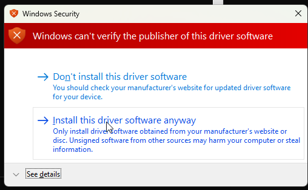

# MFS110 on Windows ARM64

An ARM64 kernel driver for the **Mantra MFS110** fingerprint scanner, so it
works on Windows 11 ARM64: Apple Silicon VMs, Snapdragon machines, and
anything else where Mantra ships no driver.

> **Status: working.** The RD Service runs, reports `READY`, and completes real
> fingerprint captures returning valid UIDAI PID blocks.
>
> **No warranty. Use at your own risk.** Best used in a virtual machine, with
> Secure Boot off.

## The problem

Mantra ships no ARM64 driver for the MFS110. Their Windows package wraps
Cypress's generic EZ-USB FX3 driver (`CyUsb3.sys`), renamed to `M0082.sys`, and
builds it for x86/x64 only. Windows ARM64 cannot load x64 kernel drivers;
there is no kernel-mode emulation, only user-mode.

So the vendor installer fails at driver binding with a misleading error, and
the scanner is unusable on Apple Silicon.

## The solution

The kernel driver turned out to be **generic USB transport with no fingerprint
logic**. It was rebuilt from Cypress's own source for ARM64. Everything above it
is user-mode, which Windows ARM64 *does* emulate, so Mantra's existing binaries
drive it unchanged.

```
MFS110 hardware
  -> CYUSB3.sys                ARM64 kernel driver   (this repo)
  -> MFS110_Core.dll           native x86 C++        (runs under emulation)
  -> MantraMFS110AVDMHost.exe  managed .NET          (unchanged)
  -> RD Service on 127.0.0.1:11100
```

## What's in this repo

| File | Purpose |
|---|---|
| `cyusb3.sys` `.inf` `.cat` | The ARM64 driver, ready to install |
| `Setup-MFS110.bat` | One-shot installer |
| `Test-MFS110.bat` | End-to-end capture check |
| `NOTICE.md` | Licensing, including conditions on the binary |
| `LICENSE` | MIT, for original work only |

Everything sits in one folder by design; the script expects the three driver
files beside it.

## Install

### 1. Prerequisites

**a. A VM running Windows 11 ARM64**

You need Windows 11 **ARM64**. Download the ISO from Microsoft and install it
in your VM:

https://www.microsoft.com/software-download/windows11

Microsoft offers both x64 and ARM64 builds. Take the **ARM64** one; this driver
will not load on x64.

Install **Windows 11 Pro**. That is the edition this has been tested against.
Test-signing is a `bcdedit` boot option rather than a Pro-specific feature, so
Home may also work, but Pro is the known-good configuration.

The ISO is multi-edition, so you choose at install time.

> On **x64** Windows none of this is necessary. Mantra's original driver works
> there.

**b. Machine settings**

- **Administrator access** - required by Windows for driver install and service
  creation; there is no user-scope path
- **Secure Boot OFF** - clear this before installing: at VM creation, or in the
  firmware settings on physical hardware. The script cannot change it, and it
  will not proceed without it.
- **Mantra's RD Service package installed to `C:\Program Files (x86)\Mantra`**

The script expects the vendor files here:

```
C:\Program Files (x86)\Mantra\RDService\L1Device\MantraMFS110AVDMHost.exe
```

If you installed elsewhere, pass the real path as an argument. The script
reports clearly if it can't find it.

### 2. Run

Double-click `Setup-MFS110.bat`, or from a prompt:

```
Setup-MFS110.bat
Setup-MFS110.bat "D:\Mantra\RDService\L1Device"     (custom path)
```

It self-elevates via UAC. What it does:

| # | Step |
|---|---|
| 1-3 | Checks elevation, ARM64, and Secure Boot |
| 4 | **Reports current state** - service registered? running? GUID present? device attached? |
| 5 | Checks the three driver files are beside the script |
| 6 | Enables test-signing |
| 7 | Creates a machine-local signing certificate, trusts it in Root + TrustedPublisher |
| 8 | Stages the driver files together, catalog renamed to match the INF |
| 9 | Signs the catalog and driver |
| 10 | Installs the driver via `pnputil` (reboots first if test-signing was just enabled) |
| 11 | Installs or updates the RD Service, registers the service if missing, restarts it |
| 12 | Verifies device, interface GUID, and port 11100 |

**If it is already installed and running**, stage 4 detects that and offers
to stop, so you are not forced through a reinstall just to check on things.

**Expect two runs.** Test-signing needs a reboot before the driver can load, so
the first run exits with code `2` and asks you to re-run after restarting. The
second completes the install.

| Exit code | Meaning |
|---|---|
| `0` | Success |
| `1` | A step failed - scroll up for the `FAIL` line |
| `2` | Reboot required, re-run afterwards |

#### Windows will warn about the driver

On the second run, when `pnputil` installs the driver, Windows shows this
dialog:



**Choose "Install this driver software anyway."**

The warning is expected, and it is accurate as far as it goes. The script
generates a certificate on your machine, signs the driver with it, and trusts
it in both `Root` and `TrustedPublisher` - but that certificate does not chain
to a Microsoft-trusted root authority, so Windows has no way to confirm who
published the driver.

It cannot chain to a trusted root, because the driver is **test-signed**
rather than WHQL-signed. Obtaining a proper signature would require
attestation signing through Microsoft, which is not available for code you do
not own.

### 3. Verify: place a finger

`Setup-MFS110.bat` only proves the service is **listening**. It does not prove
it can read a finger. `Test-MFS110.bat` does:

```
Test-MFS110.bat                  one capture
Test-MFS110.bat -Runs 5          five consecutive captures, with timing
Test-MFS110.bat -Runs 10         useful for checking reliability
```

It walks each layer, then prompts you to place a finger and reports whether the
capture succeeded:

```
=== 6. Capture 1 time(s) ===
   [1/1] waiting for finger... CAPTURED
        qScore=52  nmPoints=24  time=3.41s

=== 7. Summary ===
   captures attempted : 1
   succeeded          : 1
   failed             : 0
   average time       : 3.41s

 FINGERPRINT CAPTURE WORKS.
```

`qScore` is fingerprint quality and `nmPoints` the minutiae count; both
non-zero means a real read.

Quick manual check if you prefer:

```powershell
netstat -an | findstr 11100          # LISTENING
sc.exe query MantraMFS110AVDM        # RUNNING
```

## Why the script creates the service itself

Mantra's own installer usually **cannot complete** on these images. It declares
a dependency on `Plug And Play`:

```
DEPENDENCIES : Netman / PlugPlay / RpcSs
```

`PlugPlay` is absent from slimmed Windows images, and SCM then reports
*"the dependency service does not exist or has been marked for deletion"*, an
error with nothing to do with USB.

The script handles this: if the service isn't registered it creates one with
only `RpcSs` as a dependency.

> It uses `New-Service`, not `sc create`. The `sc` command needs literal
> embedded quotes around a path containing spaces, and PowerShell mangles them.

## Do not substitute a different driver

This build carries two changes that are **not** in the stock Cypress driver.
Both cause *silent* failures: the driver installs, the device enumerates, and
the RD Service reports no scanner with nothing logged.

**1. The interface GUID must be Mantra's.** `MFS110_Core.dll` looks up its
device with `SetupDiGetClassDevs` on `{2424460D-3D9D-45A4-A66A-D9FEF89E490B}`.
Cypress's compiled-in default `{AE18AA60-...}` will not match. Build with the
wrong one and the service searches for a device interface that was never
registered.

**2. The friendly name must be** `Mantra MFS110 Scanner Driver`. CyAPI reads it
back via `IOCTL_ADAPT_GET_FRIENDLY_NAME`, and the RD Service may validate it.

Both are already set in the bundled `cyusb3.inf`. If you regenerate the INF
from a Cypress SDK, these must be reapplied.

## Troubleshooting

| Symptom | Cause | Fix |
|---|---|---|
| Script stops at stage 3 | Secure Boot enabled | Disable in VM/firmware settings |
| Script stops at stage 5 | A driver file is not beside the script | Keep all four files in one folder |
| Driver installs, device shows `Error` | Test-signing not active | Reboot after the first run |
| Device `OK`, RD Service sees nothing | Wrong interface GUID | Check `CYUSB3.GUID` in the INF |
| RD Service won't start | `PlugPlay` dependency | The script handles this; check its output |
| RD Service starts, then `Err:-214` | Clock skew, common in resumed VMs | `w32tm /resync`, then restart the service |
| `pnputil`: "does not contain digital signature information" | INF and catalog in different folders | The script stages them together; check staging ran |

## Usage caveats

- **Test-signed, not WHQL-signed.** Secure Boot must stay **off**, and a
  **"Test Mode" watermark** appears on the desktop permanently.
- **Windows feature updates can reset test-signing.** Re-run the script.
- The hand-created RD Service lacks whatever the vendor installer would have
  configured: event log source, recovery settings, registry parameters.

## Risk and tested configuration

**No warranty.** This is unofficial third-party software. It is provided under
the MIT licence: as is, without warranty of any kind, express or implied. You
use it at your own risk. See [`LICENSE`](LICENSE).

**You are changing your machine's security posture.** Installing this requires
disabling Secure Boot and enabling test-signing. Both are system-wide settings
that exist to protect your machine, and neither can be worked around for a
driver signed this way. If that trade-off is not acceptable, do not install it.

**Virtual machines are strongly recommended.** The driver works either way. It
does not detect or require virtualisation, and nothing in it behaves
differently on real hardware.

The reason to use a VM is containment. Installing this disables Secure Boot and
enables test-signing, which are machine-wide settings, and on a physical
machine you are making those changes to the system you actually rely on. In a
VM the change is confined to a disposable guest, and if anything goes wrong you
rebuild it. Only the VM path has been tested.

**Tested configuration.** Known to work on:

- **VMware Fusion** on Apple Silicon
- **Windows 11 Pro** (ARM64)
- Mantra MFS110, `VID_2C0F` / `PID_1204`

Anything outside that is untested. Other hypervisors and other Windows editions
may work, but nobody has verified it.

**Bugs and questions.** If something does not work, raise it as an issue on
GitHub rather than assuming you have done something wrong. Include:

- Hypervisor and version
- Windows edition and build
- Which of `Setup-MFS110.bat` or `Test-MFS110.bat` failed, and its output
- Whether the device appears in Device Manager

## Licensing

Original work here is **MIT**. The driver binaries are a modified Cypress build
and carry Cypress/Infineon's terms, not MIT, including conditions on
redistribution. **Read [`NOTICE.md`](NOTICE.md) before redistributing.**

The driver source itself is not in this repository; Cypress's EULA requires
keeping it confidential. Rebuild instructions are available on request.
